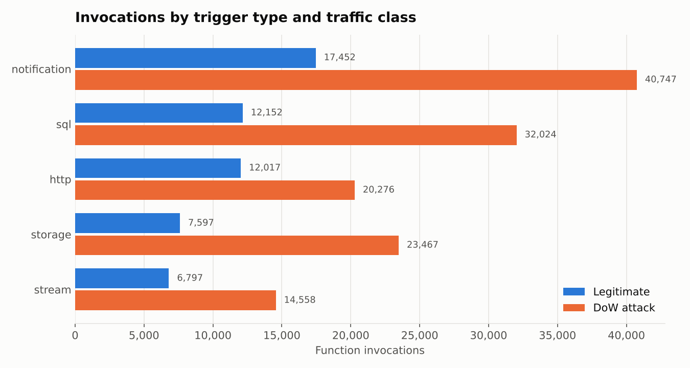
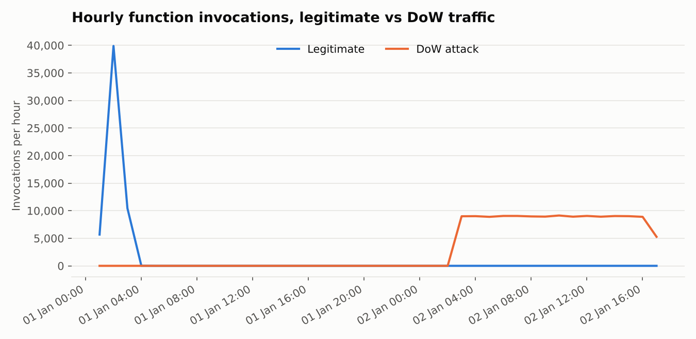
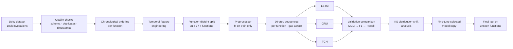

# 💸 Serverless Denial-of-Wallet Attack Detection with Temporal Deep Learning

### Detecting billing-abuse bot traffic on Function-as-a-Service platforms using LSTM, GRU and TCN models on function invocation sequences, with distribution-shift analysis and fine-tuning

> [!NOTE]
> the source code, processed data and trained models stay private. This repository only describes the approach and what I learned. The underlying dataset is public (see [Dataset](#-dataset)).

---

## 📌 Table of Contents
- [Overview](#-overview)
- [Highlights](#-highlights)
- [Dataset](#-dataset)
- [Pipeline](#-pipeline)
- [Feature Engineering](#-feature-engineering)
- [Leakage-Safe Evaluation Design](#-leakage-safe-evaluation-design)
- [Models](#-models)
- [Distribution Shift & Fine-Tuning](#-distribution-shift--fine-tuning)
- [Results Summary](#-results-summary)
- [Tech Stack](#-tech-stack)
- [Key Learnings](#-key-learnings)
- [Limitations](#-limitations)

---

## 🔭 Overview

Serverless platforms such as AWS Lambda, Azure Functions and Google Cloud Functions **auto-scale and bill per invocation**. A **Denial-of-Wallet (DoW)** attack exploits this: instead of taking a service down, a botnet repeatedly triggers functions so the victim's **cloud bill explodes**, while the service itself keeps running normally.

This project builds a detector that classifies function-invocation traffic as **legitimate or DoW bot traffic**. It does this by learning patterns over **time windows of consecutive invocations**, not from single requests in isolation.

It asks three questions:
1. Can temporal deep-learning models (**LSTM, GRU, TCN**) separate DoW traffic from legitimate traffic?
2. Do they **generalise to serverless functions never seen in training**?
3. When unseen functions show **distribution shift**, does **fine-tuning** the selected model help?

---

## ✨ Highlights

- 📦 Processed **~187k function invocations** across **45 serverless functions**.
- ⏱️ Engineered **temporal workload features**: inter-arrival time, invocations per minute, rolling 5-minute volume, total delay, concurrency change and CPU spread.
- 🧱 Built **30-step sliding-window sequences** per function, which never mix functions and never span recording gaps longer than one hour.
- 🔒 Used **function-disjoint train/validation/test splits**, so the test functions are completely unseen during training.
- 🤖 Compared **LSTM vs GRU vs TCN** on detection quality (MCC, F1, FPR/FNR, ROC/PR-AUC) and efficiency (latency, parameters, training time).
- 📉 Ran **Kolmogorov–Smirnov tests**, which found significant distribution shift in **about 73 % of features** between training and unseen functions.
- 🏆 The **LSTM** was selected. On unseen test functions it reaches **about 93 % accuracy, 0.94 F1 and 0.98 ROC-AUC**, and fine-tuning gave a small but consistent gain.

---

## 🗂️ Dataset

### Source: *Generation of a dataset for DoW attack detection in serverless architectures*, Ortega Candel, Mora Gimeno & Mora (University of Alicante), *Data in Brief*, 2024

| Resource | Link |
|---|---|
| 📦 Dataset (Mendeley Data) | https://data.mendeley.com/datasets/g8g9vdxyvn/1 |
| 📄 Data article (DOI) | https://doi.org/10.1016/j.dib.2023.109921 |
| 📄 Open-access PDF | https://rua.ua.es/dspace/handle/10045/139046 |
| 🧪 Underlying simulator (DoWTS) | [Kelly et al., IEEE S&P 2022 poster](https://www.ieee-security.org/TC/SP2022/downloads/SP22-posters/sp22-posters-20.pdf) |

This public dataset simulates **serverless function invocations** for DoW research. It was generated mainly with **DoWTS (Denial-of-Wallet Test Simulator)**, combining synthetic traffic based on cloud workload characteristics with labelled bot (attack) and legitimate requests.

### Dataset profile

| Property | Value |
|---|---|
| Records | **187,087** function invocations |
| Columns | 19 |
| Functions | 45 unique `FunctionId`s |
| Target | `bot`: **True = DoW attack** (~70 %), **False = legitimate** (~30 %) |
| Trigger types | `http`, `notification`, `sql`, `storage`, `stream` |
| Time span | 2 days of simulated traffic (Jan 2022) |

### Key fields

| Group | Columns |
|---|---|
| Identity | `Id`, `IP`, `FunctionId`, `timestamp` (**not used as model inputs**) |
| Invocation timing | `SubmitTime`, `RTT`, `InvocationDelay`, `ResponseDelay`, `FunctionDuration` |
| Concurrency | `ActiveFunctionsAtRequest`, `ActiveFunctionsAtResponse` |
| Host VM | `maxcpu`, `avgcpu`, `p95maxcpu`, `vmcategory`, `vmcorecountbucket`, `vmmemorybucket` |
| Context | `functionTrigger` |
| Label | `bot` |

### A look at the public data

  
  

The right-hand chart shows an important property of this dataset: **legitimate and attack traffic were recorded in separate time windows**. That rules out a naive chronological split and shaped the evaluation design described below.

---

## 🔬 Pipeline

---

## ⏱️ Feature Engineering

DoW attacks show up as **abnormal invocation rhythm and volume**, so behaviour-over-time features were added to the raw metrics:

| Feature | Description |
|---|---|
| `InterArrivalTime` | Seconds since the previous invocation of the **same function** |
| `FunctionInvocationsPerMinute` | Running count of invocations within the current minute, per function |
| `InvocationsLast5Min` | Rolling 5-minute invocation volume, per function |
| `TotalDelay` | Invocation delay + response delay |
| `TotalProcessingTime` | End-to-end processing / latency |
| `ActiveFunctionChange` | Change in concurrently active functions between request and response |
| `CPU_Spread` | Spread between peak and average CPU on the host VM |

**Final input:** 18 numeric features, standardised, plus 2 categorical features (trigger type and VM category), one-hot encoded. That makes **26 features per timestep**.

`IP`, `Id`, `FunctionId` and the raw timestamp are **excluded** from the inputs, so the model learns traffic behaviour rather than memorising identities.

---

## 🔒 Leakage-Safe Evaluation Design

| Safeguard | Why it matters |
|---|---|
| **Function-disjoint splits** (31 train / 7 validation / 7 test functions) | Tests whether the model generalises to **serverless functions it has never seen** |
| **Preprocessor fit on training data only** | Prevents test statistics from leaking into scaling and encoding |
| **Sequences built within one function** | A window never mixes traffic from different functions |
| **Gap-aware windows** (max gap 1 h) | A window never bridges separate recording sessions |
| **Window label = label of its last invocation** | Labels are never used to group or build the sequences |
| **Automated audits** | Checked function overlap, class presence in every split, NaN/∞ values and tensor shapes |

**Sequence datasets:** ~125k training, ~29k validation and ~31k test windows, each shaped `(30 timesteps × 26 features)`.

---

## 🤖 Models

All three models share the same data, class weights, optimiser (Adam, lr = 1e-3), batch size (256) and callbacks (early stopping, learning-rate reduction on plateau, best-checkpoint saving):

| Model | Architecture | Params |
|---|---|---:|
| **LSTM** | LSTM(64, return_sequences) → Dropout → LSTM(32) → Dropout → Dense(32) → Sigmoid | ~37k |
| **GRU** | GRU(64, return_sequences) → Dropout → GRU(32) → Dropout → Dense(32) → Sigmoid | ~28k |
| **TCN** | 4 residual dilated causal-conv blocks (64 filters, kernel 3, dilations 1·2·4·8) → Global Avg Pool → Dense(32) → Sigmoid | ~97k |

**Model selection** used a **hardware-independent ranking**: MCC first, then F1, then recall. Latency and size were reported but not used for the ranking, so the choice doesn't depend on the machine.

### Validation comparison (unseen validation functions, rounded)

| Model | Accuracy | F1 | MCC | False-positive rate | Latency / sample |
|---|---:|---:|---:|---:|---:|
| 🥇 **LSTM** | **~95 %** | **~0.96** | **~0.88** | **~6 %** | ~0.15 ms |
| TCN | ~95 % | ~0.96 | ~0.87 | ~13 % | ~0.18 ms |
| GRU | ~95 % | ~0.96 | ~0.87 | ~16 % | ~0.72 ms |

All three reach similar accuracy, but the **LSTM produces far fewer false alarms**. That matters in practice, because blocking legitimate users is costly too.

---

## 📉 Distribution Shift & Fine-Tuning

**Shift detection:** sequence-level feature summaries of the training functions and the unseen validation functions were compared with the **two-sample Kolmogorov–Smirnov test**. A feature was flagged only if it was **Bonferroni-significant and had a KS statistic of at least 0.10**.

- **About 73 % of encoded features (19 of 26) showed meaningful shift.** The strongest were RTT and processing time, function duration, delays and p95 CPU.
- The rate-based features (inter-arrival time, invocations per minute or per 5 minutes) stayed **stable across functions**. That is a useful sign that they capture attack behaviour rather than function-specific traits.

**Fine-tuning:** because the shift exceeded the predefined trigger, a **separate copy** of the selected LSTM was fine-tuned on the validation-function sequences for up to 10 epochs. The base model was kept unchanged, and both were evaluated on the **same untouched test functions**.

---

## 📊 Results Summary

Held-out **test set of 7 unseen functions** (rounded):

| Metric | Base LSTM | Fine-tuned LSTM |
|---|---:|---:|
| Accuracy | ~92.3 % | **~92.8 %** |
| Precision | ~95.4 % | **~95.5 %** |
| Recall (attack detection rate) | ~92.7 % | **~93.5 %** |
| F1 | ~0.941 | **~0.945** |
| MCC | ~0.83 | **~0.84** |
| ROC-AUC | ~0.969 | **~0.975** |
| PR-AUC | ~0.979 | **~0.984** |
| False-negative rate (missed attacks) | ~7.3 % | **~6.5 %** |

**Takeaways:**
- The detector **generalises to unseen serverless functions** with high discrimination (ROC-AUC about 0.97).
- **Fine-tuning gave a small, consistent improvement on every metric**, with the largest gains in recall and fewer missed attacks.
- Performance drops slightly from validation to test, which is expected when every test function is new.
- Inference takes **under 0.2 ms per window**, fast enough for near-real-time monitoring.

---

## 🛠️ Tech Stack

| Area | Tools |
|---|---|
| Language | Python 3.12 |
| Data | pandas, NumPy |
| Preprocessing | scikit-learn (`ColumnTransformer`, `StandardScaler`, `OneHotEncoder`) |
| Deep learning | TensorFlow / Keras (LSTM, GRU, custom TCN residual blocks) |
| Statistics | SciPy (two-sample KS test, Bonferroni correction) |
| Evaluation | scikit-learn metrics (MCC, ROC/PR-AUC, confusion matrices) |
| Visualisation | Matplotlib, Seaborn |
| Reproducibility | Fixed seeds, deterministic TensorFlow ops, saved preprocessor and metadata |

---

## 💡 Key Learnings

- **Look at the timeline before splitting.** A plain 70/15/15 chronological split would have left the validation and test sets with **only attack traffic**. Plotting the data first showed this and led to the function-disjoint design.
- **Unseen-entity evaluation is the honest test.** Splitting by function shows whether the model works on a *new* serverless function, which is how it would be deployed.
- **Accuracy alone is misleading.** All three models had about 95 % accuracy, but their false-positive rates ranged from about 6 % to 16 %. MCC and FPR/FNR exposed the real differences.
- **Rate features are the robust signal.** The KS analysis showed the behavioural rate features stay stable across functions while raw latency and CPU metrics shift heavily.
- **Be precise about what "drift" means.** The shift measured here is **between functions**, not concept drift over time. I kept those claims separate.

---

## ⚠️ Limitations

- In this dataset, **legitimate and attack traffic were recorded in separate time periods**, so some **recording-period confounding** is possible. Results show cross-function classification, not proven future-time generalisation.
- The validation functions were also used for model selection, so the fine-tuning step is **post-selection adaptation**. The test functions were never touched.
- The data is **simulated** (DoWTS-based), not production traffic from a real cloud provider.
- Next steps: longitudinal real-world traces, chronological drift evaluation, and cost-aware thresholds that trade false alarms against billing impact.

---

## 🙏 Data Acknowledgement

J. M. Ortega Candel, F. J. Mora Gimeno, H. Mora, *"Generation of a dataset for DoW attack detection in serverless architectures,"* **Data in Brief**, vol. 52, 109921, 2024. doi:10.1016/j.dib.2023.109921

---

**🔒 Source code is private

